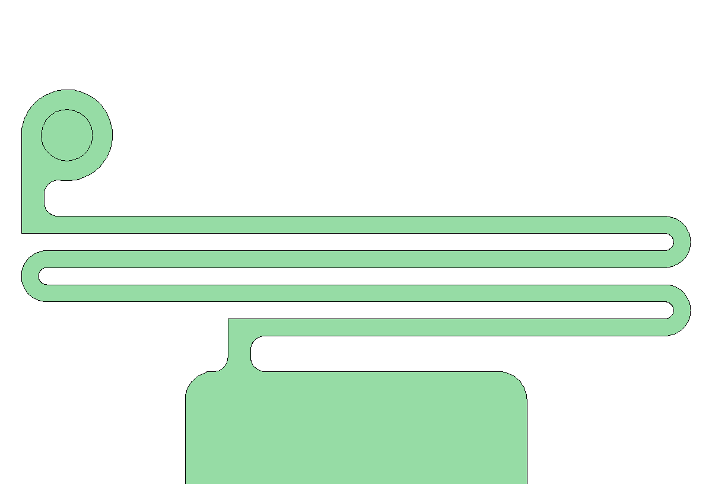
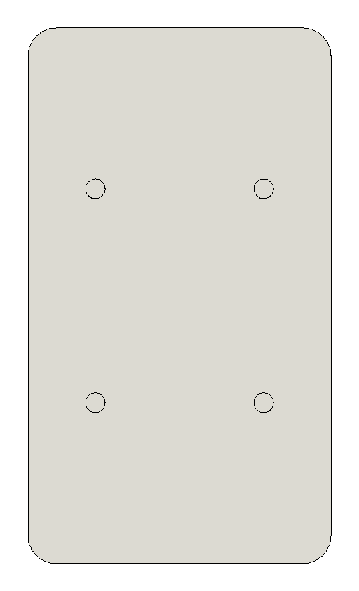

# 重力手机夹（3D 打印，结构版 v1）

| 张开状态 | 夹 75 mm 宽手机 |
|---|---|
|  |  |

## 原理
手机放上去会压住**底托**，底托往下滑。底托上有两根**驱动销**，分别插在左右**夹臂**的 45° 斜槽里。
底托下滑时，销子推着两个夹臂**同步向内收**，把手机夹住。拿走手机后，底托顶上**一体打印的折线弹簧**把底托拉回去，夹臂随之张开。**不需要金属弹簧。**
斜槽的两端同时起限位作用，所以不需要额外的挡块。

- 可夹宽度：**58 ~ 86 mm**（含手机壳），最大厚度 **13 mm**
- 底托行程 14 mm；每侧夹紧力约等于手机重量的 0.5 倍（不计摩擦和弹簧）
- 外壳 54 × 95 mm，从背面到面板总厚 20.4 mm

## 零件（`stl/` 里已经摆好打印朝向，都不需要支撑）
| 文件 | 数量 | 说明 | 打印朝向 |
|---|---|---|---|
| `base.stl` | 1 | 底壳：背板（背面 4 个安装孔）、围墙、底托导轨、弹簧挂柱、4 根螺丝柱 | 背面贴床 |
| `foot.stl` | 1 | 底托：竖直滑块、2 根 Ø5 驱动销、托盘（前沿是 45° 斜坡，会把手机往面板方向推），顶上连着折线弹簧和挂环 | 背面贴床，销子朝上，弹簧平躺 |
| `arm_l.stl` / `arm_r.stl` | 各 1 | 左右夹臂：带斜槽的滑条和夹爪（前沿有 45° 内勾，防止手机往前倒） | 滑条底面贴床 |
| `cover.stl` | 1 | 面板：手机靠的那一面，背面有 3 根导向筋，正面有贴防滑垫用的 0.6 mm 浅槽 | 正面贴床 |
| `assembly_preview.stl`, `preview_*.glb` | – | 只是预览，**不要打印** | |

**五金件**
- M3 沉头自攻螺丝 × 4，长 10 ~ 12 mm（固定面板）
- 背面安装件：见下一节

## 打印弹簧

底托顶上有 4 根并排的折条，每根厚 1.2 mm（3 条线），横向铺满壳内，约 47 mm 宽。
折条两端用**半圆 U 形弯**交替连成蛇形拉簧，最上面的圆环套在底壳左上角的挂柱上。底托往下走时，折条被拉开，同时把底托往上拽。

**防开裂的处理**：这种弹簧受力最大的位置，是折条根部和转弯处。
- 转弯全部做成圆弧，内半径 0.6 mm；
- 弹簧和底托、和圆环的连接处，都加了 1 mm 的内圆角；
- 整根弹簧里**没有一个直角内角**。

- 估算弹力（PETG）：张开时约 19 g，夹 75 mm 宽的手机时约 46 g，夹到最紧时约 87 g。普通手机重 170~230 g。
- 最大应变约 0.86%，PETG 长期使用的建议上限是 1.5%，余量充足。
- **建议用 PETG 打印。** PLA 长期一直被拉着会慢慢变形（蠕变），弹力会越来越小。
- 弹簧太软（夹臂弹不开）：`SPR_T` 改成 1.4，或者 `SPR_PRE` 改成 5。
- 弹簧太硬（夹不紧）：`SPR_T` 改成 1.0，或者 `SPR_N` 改成 6（必须是偶数）。
- 切片时墙层数设 3 或以上，折条才能打成实心的。

## 受力部位的处理（圆角 / 加强）

| 部位 | 怎么受力 | 处理 |
|---|---|---|
| 夹爪根部（夹爪和滑条相交的内角） | 手机把夹爪往外撑，这个内角受拉 | 加 R1.5 圆角。受夹爪和外壳之间 2 mm 间隙的限制，最大只能做到 R1.5，再大会碰到面板 |
| 夹爪外露棱边、45° 内勾 | 直接碰手机 | 所有棱边倒 R1，上下两端的竖棱倒 R2，不会硌手机或刮花手机壳 |
| 托盘根部（下伸杆正面和托盘顶面的内角） | 手机重量压在托盘上，这里受拉 | 加 R2 圆角 |
| 下伸杆两端（连托盘、连滑块的地方） | 托盘受力时会被掰 | 4 个内角都加 R2 圆角 |
| 托盘外露棱边、斜坡 | 碰手机 | 倒 R1 |
| 驱动销 | 竖着打印，根部受的是层与层之间的剪切 | 直径从 Ø4 加粗到 Ø5，截面强度约为原来的 2 倍 |
| 斜槽两端 | 兼作限位，手机放上去、拿下来时会被销子撞 | 两端是半圆；槽端到滑条边缘的厚度从 2.5 mm 加到 3 mm；滑条四角倒 R2 |
| 弹簧挂柱、挂环 | 一直被弹簧拉着 | 挂柱从 Ø3 加粗到 Ø3.4，挂环加大 |
| 打印弹簧 | 来回拉伸 | U 形圆弧弯，根部 R1 圆角（见上一节） |

**没有改的地方及原因：**
- **底壳围墙和背板的内角**：圆角会碰到铺满壳内的弹簧，而且这里只承受很小的力。
- **面板导向筋的根部**：筋和夹臂之间只有 0.4 mm 间隙，放不下圆角。筋本身短而粗（4 × 4.8 mm），不是薄弱点。

另外，所有零件**贴打印床的那一面都保持平直**：圆角只做在不贴床的棱边上，所以仍然不需要支撑。

## 背面 4 个安装孔（已按实测尺寸）

用来固定到球头支架的金属安装板上。实测数据：
- 用卡尺量的是两孔**靠近一侧边缘之间**的距离，读数分别是 24.9 和 33.0，对角线读数 43.5；
- 孔径 5.1 mm；
- 加上一个孔径，就是孔**中心距 30.0 × 38.1 mm**，对角线 48.6。按 √(30.0² + 38.1²) = 48.5 验算，三个读数互相吻合。

| 项目 | 数值 |
|---|---|
| 孔位 | 以背板中心为中心的 30.0（横）× 38.1（竖）矩形 |
| 孔 | Ø3.5 盲孔，深 6.5 mm，按 **M4 自攻螺丝**设计 |
| 背板 | 加厚到 8 mm，孔底还留 1.5 mm，不会打穿到机构里 |
| 螺丝 | M4 自攻，长度约为"金属板厚度 + 6 mm"，比如 M4×8 |

金属板装在球头上，可以转着装，横竖方向不用纠结。如果想用热熔铜螺母（拆装次数多时更耐用），把 `MOUNT_HOLE_D` 改成螺母说明书上要求的孔径就行。

## 组装
1. 底托的下伸杆从底壳底墙的开口穿出去，把底托放进底壳。
2. 把弹簧顶端的圆环**往上拉约 4 mm**（这是预紧），套到底壳左上角的挂柱上。
3. 放入右夹臂（位置较低的那根滑条，从右墙开口穿出），让底托的下方销子进入斜槽。
4. 放入左夹臂（位置较高，从左墙开口穿出），让上方销子进入斜槽。
5. 盖上面板，导向筋会卡在两根滑条的上下两侧，然后拧 4 颗螺丝。
6. 用手往下按底托，两个夹臂应该同步收拢；松手后应该自己弹开。

## 打印建议
PETG 或 PLA，层高 0.2，3 层墙，填充 25%。滑动面不要开熨烫。
`CL = 0.3` 是滑动间隙。如果滑动发涩，就把它改成 0.35 或 0.4，然后重新生成。

## 常用参数（都在 `build_holder.py` 开头）
| 参数 | 默认 | 作用 |
|---|---|---|
| `TRAVEL` | 14 | 底托行程，决定开口范围 |
| `RATIO` | 1.0 | 夹臂行程 / 底托行程。改小（比如 0.7）夹得更紧，但开口范围变小 |
| `PHONE_T` | 13 | 可夹的最大厚度 |
| `JAW_Y` | 16~64 | 夹爪高度范围 |
| `W` | 54 | 外壳宽（高度根据弹簧长度自动算出） |
| `SPR_N` / `SPR_T` / `SPR_PRE` | 4 / 1.2 / 4 | 弹簧折条数 / 厚度 / 预紧量 |
| `CL` | 0.3 | 滑动间隙 |

重新生成：`python3 build_holder.py`（依赖：`pip install manifold3d trimesh numpy`）。
脚本会把零件放在 8 个行程位置逐一做布尔求交。任何两个零件有干涉都会报错，不会输出有问题的模型。

渲染预览：`node render3d.js stl/preview_open.glb out.png [camX camY camZ targetZ fov]`
