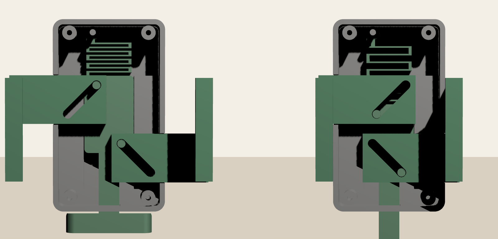
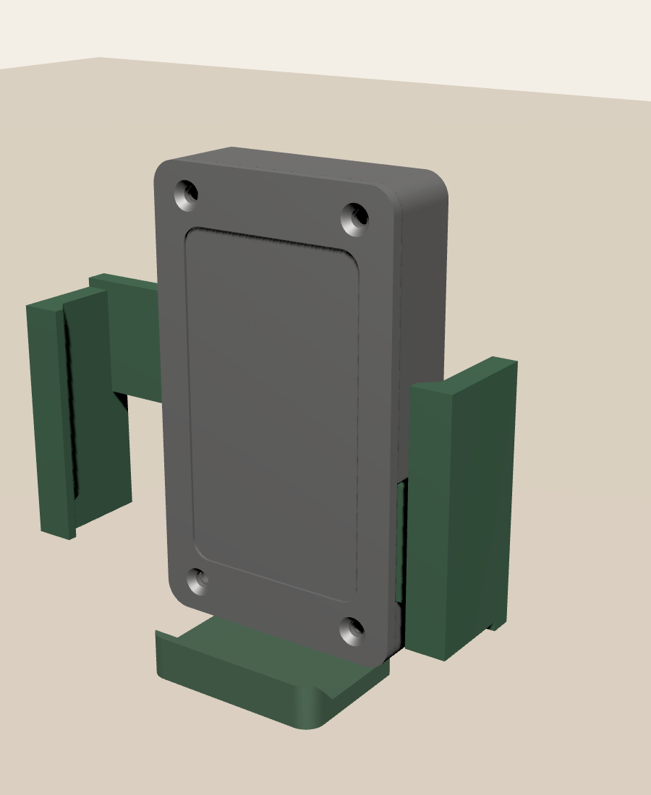
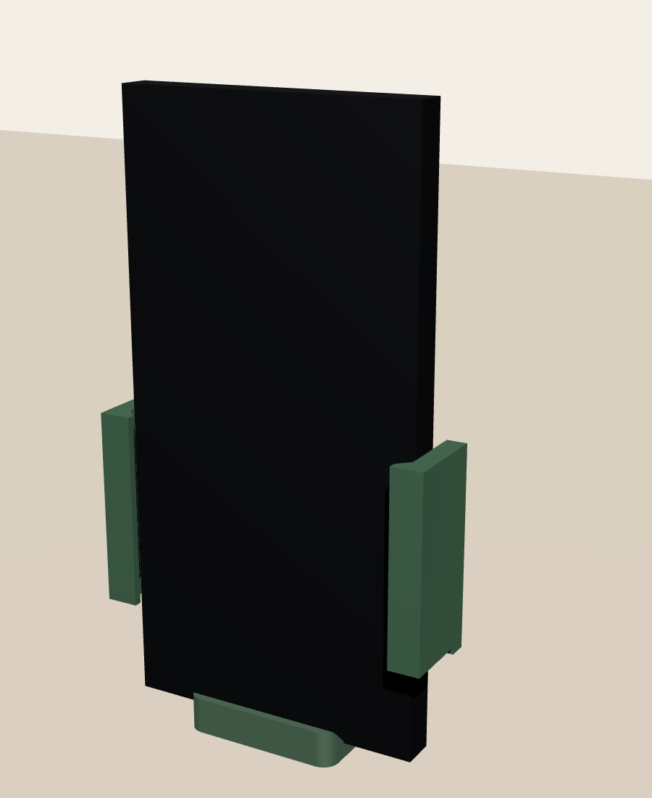

# 重力手机夹（3D 打印，结构版 v1）



| 张开状态 | 夹 75 mm 宽手机 |
|---|---|
|  |  |

## 原理
手机放上去会压住**底托**，底托往下滑。底托上有两根**驱动销**，分别插在左右**夹臂**的 45° 斜槽里。
底托下滑时，销子推着两个夹臂**同步向内收**，把手机夹住。拿走手机后，底托顶上**一体打印的折线弹簧**把底托拉回去，夹臂随之张开。**不需要金属弹簧。**
斜槽的两端同时起限位作用，所以不需要额外的挡块。

- 可夹宽度：**58 ~ 86 mm**（含手机壳），最大厚度 **13 mm**
- 底托行程 14 mm；每侧夹紧力约等于手机重量的 0.5 倍（不计摩擦和弹簧）
- 外壳 54 × 93 mm，从背面到面板总厚 18.4 mm

## 零件（`stl/` 里已经摆好打印朝向，都不需要支撑）
| 文件 | 数量 | 说明 | 打印朝向 |
|---|---|---|---|
| `base.stl` | 1 | 底壳：背板（背面 4 个安装孔）、围墙、底托导轨、弹簧挂柱、4 根螺丝柱 | 背面贴床 |
| `foot.stl` | 1 | 底托：竖直滑块、2 根 Ø4 驱动销、托盘（前沿是 45° 斜坡，会把手机往面板方向推），顶上连着折线弹簧和挂环 | 背面贴床，销子朝上，弹簧平躺 |
| `arm_l.stl` / `arm_r.stl` | 各 1 | 左右夹臂：带斜槽的滑条和夹爪（前沿有 45° 内勾，防止手机往前倒） | 滑条底面贴床 |
| `cover.stl` | 1 | 面板：手机靠的那一面，背面有 3 根导向筋，正面有贴防滑垫用的 0.6 mm 浅槽 | 正面贴床 |
| `assembly_preview.stl`, `preview_*.glb` | – | 只是预览，**不要打印** | |

**五金件**
- M3 沉头自攻螺丝 × 4，长 10 ~ 12 mm（固定面板）
- 背面安装件：见下一节

## 打印弹簧
底托顶上有 8 根并排的细折条（每根厚 0.8 mm、长 22 mm），两端交替连起来，形成一根蛇形拉簧。最上面的圆环套在底壳的挂柱上。
底托往下走时，折条被拉开，同时把底托往上拽。

- 估算弹力（PETG）：张开时约 20 g，夹 75 mm 宽的手机时约 58 g，夹到最紧时约 116 g。普通手机重 170~230 g，扣掉弹力后剩下的重量足够夹住手机。
- 最大应变约 1.2%，在 PETG 的安全范围内。
- **建议用 PETG 打印。** PLA 长期一直被拉着会慢慢变形（蠕变），弹力会越来越小。
- 太软（夹臂弹不开）：`SPR_T` 改成 0.9 或 1.0，或者 `SPR_PRE` 改成 4。
- 太硬（夹不紧）：`SPR_N` 改成 9 或 10。外壳会跟着自动变高。
- 切片时折条按 2 条线打，**不要开稀疏填充**（墙层数设 2 或以上就行）。

## 背面 4 个安装孔（⚠ 现在是占位尺寸）
安装孔是从背面开的盲孔，深 4 mm。背板厚 6 mm，孔不会打穿到机构里。
**孔位尺寸还没定**，现在暂时按 30 × 40 mm 的矩形摆放。拿到实测尺寸后，改 `build_holder.py` 开头的这几行：

```python
MOUNT_HOLES = [(-15.0, -20.0), (15.0, -20.0), (-15.0, 20.0), (15.0, 20.0)]  # 相对背板中心 (x 横向, y 竖向)
MOUNT_HOLE_D = 4.0       # M3 热熔铜螺母用 4.0；直接拧 M3 自攻用 2.6；M4 自攻用 3.4
MOUNT_HOLE_DEPTH = 4.0
```

背板可用范围是 54 × 93 mm（孔坐标是相对背板中心的），孔中心离边缘至少要留约 3.5 mm。脚本会检查孔是否超出背板。

## 组装
1. 底托的下伸杆从底壳底墙的开口穿出去，把底托放进底壳。
2. 把弹簧顶端的圆环**往上拉约 3 mm**（这是预紧），套到底壳左上角的挂柱上。
3. 放入右夹臂（位置较低的那根滑条，从右墙开口穿出），让底托的下方销子进入斜槽。
4. 放入左夹臂（位置较高，从左墙开口穿出），让上方销子进入斜槽。
5. 盖上面板，导向筋会卡在两根滑条的上下两侧，然后拧 4 颗螺丝。
6. 用手往下按底托，两个夹臂应该同步收拢；松手后应该自己弹开。

## 打印建议
PETG 或 PLA，层高 0.2，3 层墙，填充 25%。滑动面不要开熨烫。
`CL = 0.3` 是滑动间隙。如果滑动发涩，就把它改成 0.35 或 0.4，然后重新生成。

## 常用参数（都在 `build_holder.py` 开头）
| 参数 | 默认 | 作用 |
|---|---|---|
| `TRAVEL` | 14 | 底托行程，决定开口范围 |
| `RATIO` | 1.0 | 夹臂行程 / 底托行程。改小（比如 0.7）夹得更紧，但开口范围变小 |
| `PHONE_T` | 13 | 可夹的最大厚度 |
| `JAW_Y` | 16~64 | 夹爪高度范围 |
| `W` | 54 | 外壳宽（高度根据弹簧长度自动算出） |
| `SPR_N` / `SPR_T` / `SPR_PRE` | 8 / 0.8 / 3 | 弹簧折条数 / 厚度 / 预紧量 |
| `CL` | 0.3 | 滑动间隙 |

重新生成：`python3 build_holder.py`（依赖：`pip install manifold3d trimesh numpy`）。
脚本会把零件放在 8 个行程位置逐一做布尔求交。任何两个零件有干涉都会报错，不会输出有问题的模型。

渲染预览：`node render3d.js stl/preview_open.glb out.png [camX camY camZ targetZ fov]`
